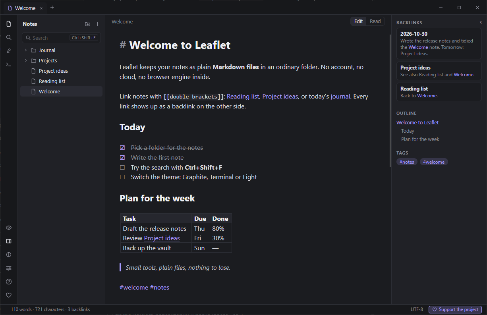
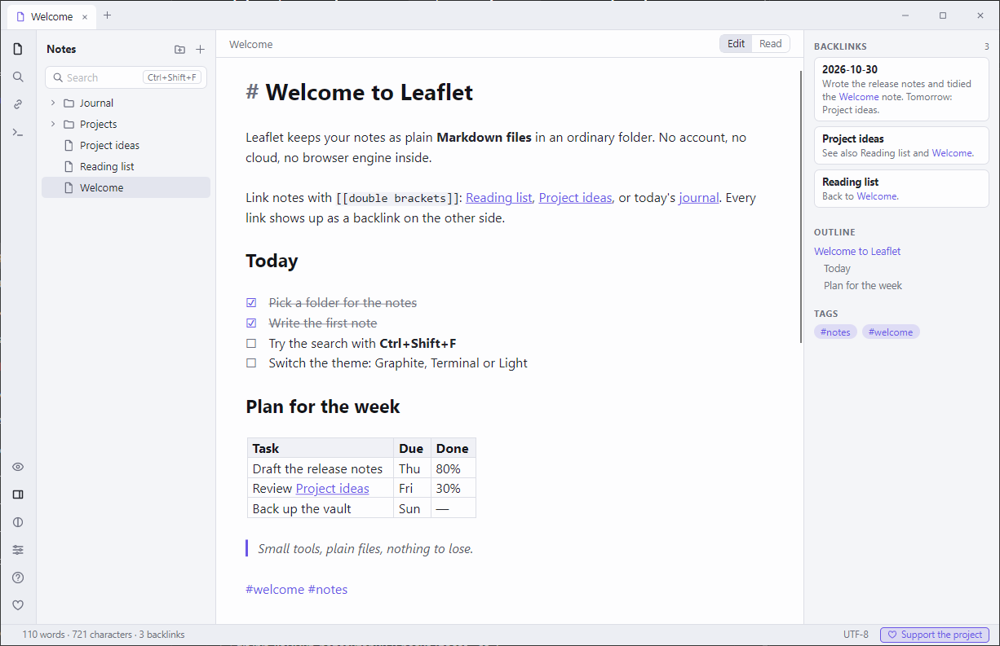
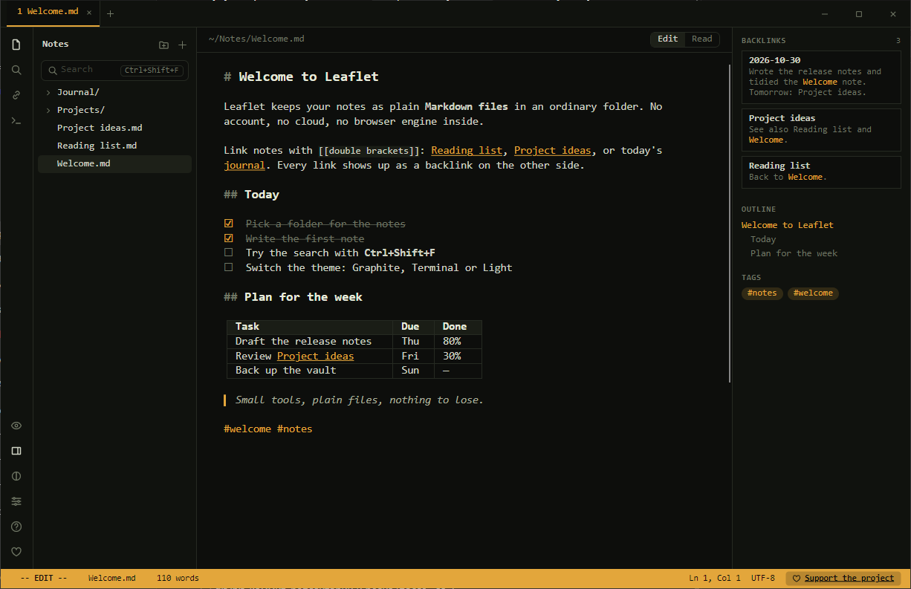

<p align="center">
  <a href="https://dalink.to/olegche"></a>
</p>

# Leaflet

[Русский](README.md) · **English**

[](../../releases/latest)
[](../../releases)
[](#install)
[](LICENSE)

A lightweight note-taking app for Windows with **no embedded browser**: your notes are plain Markdown files in an ordinary folder. It has `[[links]]` between notes, backlinks, tags, search, live preview right in the editor, and export to HTML and PDF. No accounts, no cloud: your files stay with you.



**[⬇ Download the latest version (zip)](https://github.com/OlegChe77/leaflet/releases/latest/download/Leaflet.zip)** (`Leaflet.zip`, about 50 MB)

Nothing to install: the zip holds a folder with `Leaflet.exe`, and .NET is already included. Works on Windows 10 and 11.

## Features

- **Notes are plain `.md` files.** Open any folder: every `.md` file in it and its subfolders becomes a note. Renaming or moving a note fixes the `[[links]]` in all the others.
- **Links and backlinks.** `[[Name]]`, `[[Name#Section]]`, `[[Name|label]]`; typing `[[` shows suggestions. The right panel lists who links to the note, its outline and tags.
- **Live preview.** The line with the cursor shows raw Markdown, everything else is rendered. Tables, lists, checkbox tasks, footnotes, code, quotes, images, and embedding one note inside another (`![[Name]]`).
- **Search and replace** across all notes, `#tag` and `#project/site` tags, a command palette on **Ctrl+P**.
- **Images and attachments:** paste from the clipboard or drag and drop; files are copied to an `assets` folder.
- **Data safety:** autosave, crash drafts, version history with restore, protection against edits made to the file outside the app.
- **Export** one note or all of them to HTML and PDF, in the colors of the current theme.
- **Three themes:** Graphite, Terminal and Light. The interface is in **Russian and English**; hotkeys are configurable.
- Fast start (about a second), single instance, portable mode.

|  |  |
|:--|:--|
| Light theme | Terminal theme |

## Install

1. Download **[Leaflet.zip](https://github.com/OlegChe77/leaflet/releases/latest/download/Leaflet.zip)** (always the latest version).
2. Unzip it to any folder, for example `Documents`.
3. Run `Leaflet.exe` and pick your notes folder (**Ctrl+Shift+O**). A desktop shortcut is created on the very first launch.

If Windows shows the blue SmartScreen window ("Windows protected your PC"): the app is not code-signed. Click "More info" → "Run anyway". The source code is open, so you can build it yourself (see below).

Uninstall: delete the program folder and the shortcut. While `portable.txt` lies next to `Leaflet.exe`, settings, drafts and versions are kept in the `data` folder next to the program; delete `portable.txt` to use `%APPDATA%\Leaflet` instead.

## Help

The full help (in Russian and English) is built into the app: the "?" button on the left or **F1**. The same text is in [Help.md](Help.md).

Main hotkeys: **Ctrl+P** command palette, **Ctrl+O** open a note by name, **Ctrl+N** new note, **Ctrl+Shift+F** search all notes, **Ctrl+E** edit / read, **Ctrl+,** settings.

## Build from source

You need the .NET 8 SDK. Stack: C# + [Avalonia](https://avaloniaui.net/) 12 + [AvaloniaEdit](https://github.com/AvaloniaUI/AvaloniaEdit).

```
dotnet build src/Leaflet -c Release
src/Leaflet/bin/Release/net8.0/Leaflet.exe samples/vault
powershell -ExecutionPolicy Bypass -File build.ps1      # package: folder and zip in dist/
```

Self-test (works on a copy of the folder and takes over the keyboard and mouse for a few minutes):

```
Leaflet.exe <copy of samples/vault> --selftest <empty folder>
```

## Support the project

If the app is useful to you, you can support the author here: **https://dalink.to/olegche**. It is the same as the "Support the project" button inside the app.

## License

[MIT](LICENSE)
