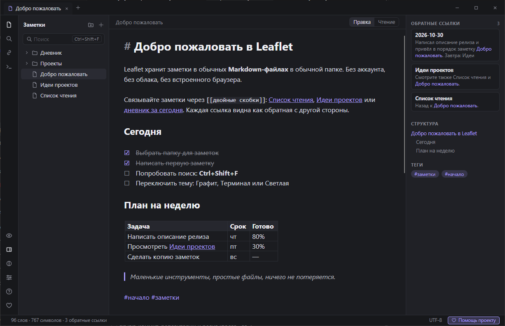
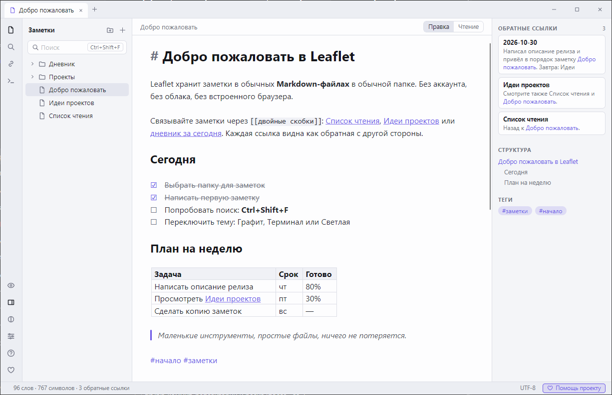
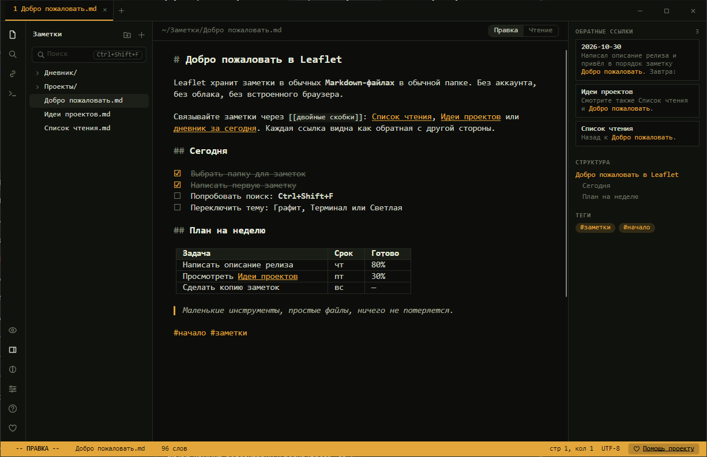

<p align="center">
  <a href="https://dalink.to/olegche"></a>
</p>

# Leaflet

**Русский** · [English](README.en.md)

[](../../releases/latest)
[](../../releases)
[](#установка)
[](LICENSE)

Лёгкий заметочник для Windows **без встроенного браузера**: ваши заметки — обычные Markdown-файлы в обычной папке. Есть `[[ссылки]]` между заметками, обратные ссылки, теги, поиск, живой просмотр прямо в редакторе и экспорт в HTML и PDF. Никаких аккаунтов и облака: файлы остаются у вас.



**[⬇ Скачать последнюю версию (zip)](https://github.com/OlegChe77/leaflet/releases/latest/download/Leaflet.zip)** (`Leaflet.zip`, около 50 МБ)

Ставить ничего не нужно: внутри папка с `Leaflet.exe`, .NET уже включён. Работает на Windows 10 и 11.

## Возможности

- **Заметки — обычные `.md`-файлы.** Откройте любую папку: все `.md` в ней и во вложенных папках станут заметками. Переименование и перенос заметки сами правят `[[ссылки]]` во всех остальных.
- **Ссылки и обратные ссылки.** `[[Имя]]`, `[[Имя#Раздел]]`, `[[Имя|подпись]]`; при наборе `[[` появляется подсказка. Справа видно, кто ссылается на заметку, структуру по заголовкам и теги.
- **Живой просмотр.** Строка с курсором показывает исходный Markdown, остальные — оформленный текст. Таблицы, списки, задачи с флажками, сноски, код, цитаты, картинки и встраивание одной заметки в другую (`![[Имя]]`).
- **Поиск и замена** по всем заметкам, теги `#тег` и `#проект/сайт`, палитра команд **Ctrl+P**.
- **Картинки и вложения:** вставка из буфера обмена и перетаскивание, файлы копируются в папку `assets`.
- **Надёжность данных:** автосохранение, черновики на случай сбоя, история версий с возвратом, защита от правок файла снаружи.
- **Экспорт** одной заметки или всех сразу в HTML и PDF, в цветах выбранной темы.
- **Три темы:** «Графит», «Терминал» и «Светлая». Интерфейс на **русском и английском**, горячие клавиши настраиваются.
- Быстрый запуск (около секунды), один экземпляр программы, портативный режим.

|  |  |
|:--|:--|
| Тема «Светлая» | Тема «Терминал» |

## Установка

1. Скачайте **[Leaflet.zip](https://github.com/OlegChe77/leaflet/releases/latest/download/Leaflet.zip)** (всегда последняя версия).
2. Распакуйте в любую папку, например в `Документы`.
3. Запустите `Leaflet.exe` и выберите папку с заметками (**Ctrl+Shift+O**). При самом первом запуске на рабочем столе появится ярлык.

Если Windows показала синее окно SmartScreen («Windows защитила ваш компьютер»): программа не подписана цифровой подписью. Нажмите «Подробнее» → «Выполнить в любом случае». Исходный код открыт, можно собрать самому (см. ниже).

Удаление: удалите папку с программой и ярлык. Пока рядом с `Leaflet.exe` лежит `portable.txt`, настройки, черновики и версии хранятся в папке `data` рядом с программой; если удалить `portable.txt` — в `%APPDATA%\Leaflet`.

## Справка

Полная справка (на русском и английском) встроена в программу: кнопка «?» слева или **F1**. Тот же текст лежит в файле [Help.md](Help.md).

Основные сочетания: **Ctrl+P** — палитра команд, **Ctrl+O** — открыть заметку по имени, **Ctrl+N** — новая, **Ctrl+Shift+F** — поиск по всем заметкам, **Ctrl+E** — правка или чтение, **Ctrl+,** — настройки.

## Сборка из исходников

Нужен .NET 8 SDK. Стек: C# + [Avalonia](https://avaloniaui.net/) 12 + [AvaloniaEdit](https://github.com/AvaloniaUI/AvaloniaEdit).

```
dotnet build src/Leaflet -c Release
src/Leaflet/bin/Release/net8.0/Leaflet.exe samples/vault
powershell -ExecutionPolicy Bypass -File build.ps1      # поставка: папка и zip в dist/
```

Самопроверка (работает на копии папки, берёт на себя клавиатуру и мышь на несколько минут):

```
Leaflet.exe <копия samples/vault> --selftest <пустая папка>
```

## Помощь проекту

Если программа пригодилась, поддержать автора можно здесь: **https://dalink.to/olegche**. Это же — кнопка «Помощь проекту» в самой программе.

## Лицензия

[MIT](LICENSE)
